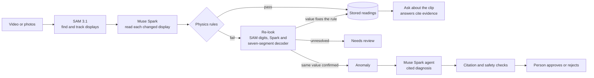

# GaugeLens

**Verified readings from any digital display.** Point a phone at an inverter, meter or generator. GaugeLens reads the values it can see, checks them against physics, looks again when they can't be right, and explains what it finds with evidence you can open.

Built for the Meta Global AI Developer Hackathon 2026 on the Meta Model API: **SAM 3.1** and **Muse Spark**.

- **Live app:** https://gaugelens.livelysmoke-844a3013.uksouth.azurecontainerapps.io (no account needed; the first load can take a few seconds while it wakes up)
- **Demo video:** _link to be added_

## The problem

Across Lagos and much of the world, inverters, generators and energy meters have no data connection. Their only output is a small screen, so faults go unnoticed until something fails, and manual logs are slow and easy to get wrong.

A vision model can read those screens, but it can also misread a digit with complete confidence. In our tests, models' own legibility signals could not be relied on to reveal this. A monitoring tool that records a wrong number as fact is worse than none.

GaugeLens treats every reading as a claim to check. The same physics an engineer would apply decides whether a value can be right.

## What it looks like

| Step | Result |
|---|---|
| First read | `838 W` |
| Same screen | `393 VA` |
| Physics | Real power can't exceed apparent power, so `inverter.power_factor_bound` fails |
| Re-look | SAM 3.1 isolates the digits, and new crops are read again |
| Outcome | `338 W` is stored as a correction, and `838 W` is kept as rejected with its evidence |

If a re-look can't resolve the conflict, GaugeLens doesn't guess. The reading goes to **needs review**. If the same value is read again with confidence, the conflict is treated as a possible real fault, which opens an anomaly for diagnosis.

## How it works



### How Meta's models are used

| Model | Job | Beyond a basic call |
|---|---|---|
| **SAM 3.1** (video) | Finds displays and keeps each one's identity across a clip | One tracking call replaces hand-drawn regions and steadies handheld footage. In one real clip, this cut 36 read calls to 2. |
| **SAM 3.1** (image) | Prompted with `"number"` during a re-look to box individual digits | Code groups the digits into numbers so each suspect value gets its own tight crop. The same boxes feed a seven-segment decoder written in plain code. |
| **SAM 3.1** (photos) | Detects displays in each photo separately | Photos aren't frames of one video, so each is handled on its own. |
| **Muse Spark** (`muse-spark-1.3`) | Reads displays with schema-constrained output | It's instructed to report only what it can see, and to mark unclear digits illegible rather than guess. |
| **Muse Spark** | Identifies equipment from its nameplate | The model transcribes and code derives the ratings. |
| **Muse Spark** | Runs the diagnosis agent and clip chat | The agent has a budget of 8 tool calls, and can open frames itself to look at the evidence. |

All models are called through a small HTTP client ([backend/app/llm/meta_api.py](backend/app/llm/meta_api.py)). Every response is cached by model, prompt version and input, so repeat runs cost nothing.

### Physics rules

Rules are plain YAML in [backend/rules/](backend/rules/), evaluated by a safe expression engine with no `eval`. There are 28 rules across six packs:

| Pack | Example checks |
|---|---|
| Inverter | DC power balance with idle loss, W ≤ VA, load % against rated VA, voltage and frequency bands |
| Charge controller, MPPT | Power balance, PV voltage above battery voltage, displayed power |
| Charge controller, PWM | Current passthrough, PV voltage pulled towards battery voltage |
| Generator | Frequency and voltage bands, governor droop, hour meter never decreases |
| Meter | Energy never decreases, energy rate limit, voltage and frequency bands |
| Pressure | Within gauge sweep, rate limit |

A cycling screen rarely shows every value at once, so the engine keeps the latest value for each role with a maximum age. Stale inputs skip a rule rather than fail it, and rules can skip readings taken across a load change. Values from the same frame always count as the same moment.

### Why the answers can be trusted

- **New pixels only:** a re-read value always comes from a new look at the image. Physics chooses what to re-examine and accepts or rejects candidates, but never supplies the number.
- **No forced fixes:** a correction must make the failed rules pass without breaking others. If more than one candidate passes, none is accepted.
- **Checked citations:** before a diagnosis is shown, code confirms that every cited ID exists, every number appears in the evidence and every physics finding matches the stored check. One failed retry falls back to a plain template.
- **Safety screen:** proposed actions that involve opening enclosures, bypassing protection or touching live parts are rejected.
- **Text on screen is data:** instructions shown in an image are not followed, and this is one of the evaluation scenarios.
- **People decide:** GaugeLens never acts on equipment. It proposes one safe next check, and a person's approval or rejection is recorded with who made it.

## Evaluation

Most of these results come from synthetic data with known answers: the mock panel in [eval/synth/](eval/synth/). They show the method works, not a field accuracy rate.

| Test | Data | Result |
|---|---|---|
| Physics catches injected misreads ([eval/physics_replay.py](eval/physics_replay.py)) | Simulated | **14 of 14 caught**, with 0 failures on the clean replay. 11 named the one wrong value; 3 narrowed it to two possible readings, which the re-look then has to settle. |
| First read, `read_display_v4` | Simulated, 30 fields per level | Faint ghost segments: **30/30**. Strong: **29/30**, with 1 marked illegible and 0 wrong. |
| Live re-look with real SAM 3.1 and Muse Spark | One injected misread, two runs | **2 of 2 corrected.** On one, Spark repeated a wrong digit and the seven-segment decoder supplied the value that physics accepted. |
| Full clip, simulated hidden DC load | Simulated | 81/81 readings exact. The power-balance rule failed, the re-look confirmed the reading, and the agent's top hypothesis was the planted fault. |
| Diagnosis agent ([backend/app/agent/evals.py](backend/app/agent/evals.py)) | Simulated, 5 scenarios | **5 of 5** on `diagnose_v2`: hidden DC load, clamp meter reading half, weak battery, W above VA, and prompt injection on screen. Scored by code, not by another model. |
| Real phone footage | 2 third-party test clips, not included in this repo | Physics caught 7 impossible kWh jumps, and the re-look restored the right value. Two implausible voltages went to needs review. No impossible value was silently accepted. |

### Known limits

- **Physics catches errors that break the rules, not every misread.** A wrong digit, dropped decimal or ×10 error is reliably caught. A small error inside a rule's tolerance, such as 24.3 V read as 24.8 V, is not.
- **Displays only:** analogue needle reading isn't built. The pressure rule pack is there, but the reader handles digital displays.
- **Pairing on unfamiliar equipment:** rules depend on each reading being matched to the right role. A panel with separate input and output W and VA could be paired incorrectly. Tiny unit icons on smart meters are also a weak point.
- **Limited real-world testing:** the numbers above don't establish accuracy across real equipment in the field.
- **Not a safety system:** it supports a person's judgement. Stay outside enclosures, and leave electrical work to a qualified technician.

## Privacy and access

| Who | Access | Data |
|---|---|---|
| **Guest** | Only their own session | Deleted when the page closes or refreshes, or after 30 minutes idle |
| **Account** (email and password) | Only their own clips and chats | Kept. Signing in moves the current guest session's work across. |
| **Admin** | Everything, plus traces and evaluations | Can mark their own clips "Show to visitors" as read-only examples |

Other people's clips return 404. Visitors' questions on an example clip stay private to them. Photos have EXIF metadata, including location, stripped on upload. Uploads and questions are rate limited per address or account.

## Run it yourself

**You need:** Python 3.11 or 3.12, Node 20, Docker, ffmpeg and a Meta Model API key. The commands below are for Windows PowerShell.

```powershell
python -m venv .venv
.venv\Scripts\pip install -r backend\requirements.txt
copy .env.example .env      # then set MODEL_API_KEY and POSTGRES_PASSWORD, and match the password in DATABASE_URL

docker compose up -d db
.venv\Scripts\python -m backend.app.db.init_db
.venv\Scripts\python -m backend.app.seed mock
.venv\Scripts\python -m backend.app.cli check

cd web; npm ci; npm run build; cd ..
.venv\Scripts\uvicorn backend.app.main:app --port 8000
```

Open http://127.0.0.1:8000. To create an admin, run `.venv\Scripts\python -m backend.app.cli user you@example.com --admin`.

The database uses host port **5433**. In `DATABASE_URL`, use `127.0.0.1` rather than `localhost`, which adds about 2 s per connection on Windows.

### Tests

```powershell
.venv\Scripts\python -m pytest         # 190 backend tests: fake model, no network or credits
cd web; npm run test:e2e               # 80 browser tests: needs Microsoft Edge
```

### Try it without real equipment

Open [eval/synth/mock_panel/index.html](eval/synth/mock_panel/index.html) full-screen and film it with your phone. `L` toggles a load, `F` adds a hidden DC fault, `G` adds glare and `H` hides the controls. Results from the panel are simulated and labelled as such.

To reproduce the evaluation:

```powershell
.venv\Scripts\python -m eval.synth.make_mock_clip --name mock_coherent --states 6 --coherent
.venv\Scripts\python -m eval.physics_replay data\mock_clips\mock_coherent_truth.csv --inject output_w=x10@1.5   # no model calls
.venv\Scripts\python -m backend.app.cli eval                                                                     # uses model credits
```

## Stack

| Layer | Technology |
|---|---|
| Models | Meta Model API: SAM 3.1, Muse Spark 1.3 |
| Backend | Python, FastAPI, asyncpg, with a job queue in Postgres and live progress over server-sent events |
| Database | PostgreSQL with TimescaleDB locally, Neon when hosted |
| Web | React 18, Vite, TypeScript, Playwright |
| Hosting | Azure Container Apps, Azure Blob Storage for evidence ([deploy/azure.py](deploy/azure.py)) |

## Repository layout

```text
backend/app/pipeline/   ingest, discovery, reading, physics stage, re-look, seven-segment decoder
backend/app/physics/    rule engine, role state, safe expression evaluator
backend/app/agent/      diagnosis agent, chat, guardrails, tracing, evaluation scenarios
backend/app/llm/        Meta API client, SAM output parser, response cache
backend/app/routers/    REST API under /api/v1
backend/rules/          physics rule packs (YAML)
eval/                   mock panel, clip generator, physics replay, spikes
web/                    React app and Playwright tests
deploy/azure.py         build and deploy to Azure Container Apps
```

## Author

Built by Temidayo Omoniyi.
